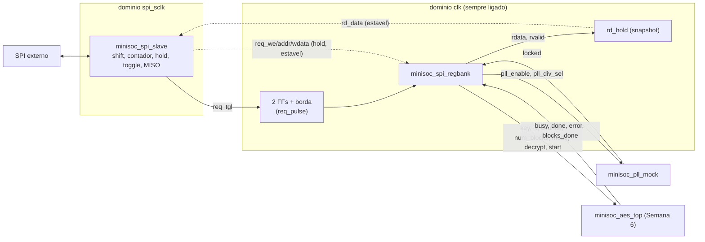

# SPI, banco de registradores e PLL mock — v1.0 (Semana 5)

Documento de projeto dos blocos `minisoc_spi` (com `minisoc_spi_slave` e `minisoc_spi_regbank`) e
`minisoc_pll_mock`. Complementa [`microarquitetura_v1.0.md`](microarquitetura_v1.0.md), seções 4 e 5.

> **Estado: rascunho a conferir com o Block Guide.** As seções 5, 6 e 9 do Block Guide não estão em
> `docs/spec/`. O backlog fixa só os nomes dos registradores e as regras gerais (modo 0, frame de 40 bits,
> leitura em duas transações com NOP `0x3F`, `PLL_DIV_SEL` em /1, /2, /4, /8). Todo o resto é **premissa**
> e está na seção 6 deste documento. Os valores ficam em `rtl/minisoc_spi/minisoc_regs_pkg.sv`, e os
> testbenches importam o mesmo pacote, então corrigir um endereço ou campo é editar um arquivo.

---

## 1. Hierarquia

| Módulo | Arquivo | Domínio | Função |
| --- | --- | --- | --- |
| `minisoc_regs_pkg` | `rtl/minisoc_spi/minisoc_regs_pkg.sv` | — | Endereços, campos, valores, formato do frame |
| `minisoc_spi_slave` | `rtl/minisoc_spi/minisoc_spi_slave.sv` | `spi_sclk` | Recepção do frame, hold, toggle e MISO |
| `minisoc_spi_regbank` | `rtl/minisoc_spi/minisoc_spi_regbank.sv` | `clk` | Registradores e saídas de configuração |
| `minisoc_spi` | `rtl/minisoc_spi/minisoc_spi.sv` | os dois | Slave, sincronizador do toggle, regbank e snapshot de leitura |
| `minisoc_pll_mock` | `rtl/minisoc_pll/minisoc_pll_mock.sv` | `clk` → `sys_clk` | Modelo do PLL (não sintetizável) |

---

## 2. Protocolo SPI

Modo 0 (CPOL = 0, CPHA = 0), MSB primeiro. `mosi` é amostrado na subida de `spi_sclk` e `miso` muda
na descida. Frame de 40 bits: `{RW, addr[6:0], data[31:0]}`, com `RW = 1` para escrita.

| Operação | Sequência |
| --- | --- |
| Escrita | 1 frame `{1, addr, wdata}` |
| Leitura | frame 1 `{0, addr, don't care}` pede o registrador; frame 2 `{0, 0x3F, don't care}` devolve o valor em `miso`, nos 32 bits de dados (bits 9 a 40) |

Regras do escravo:

1. `spi_cs_n` alto zera o registrador de deslocamento e o contador de bits. **Frame interrompido é descartado.**
2. O commit acontece no 40º bit. Depois dele, clocks extras são ignorados (o contador satura em 40).
3. Frame com `addr = 0x3F` (NOP) não gera requisição, seja leitura ou escrita.
4. **Em qualquer frame de leitura**, o `miso` devolve o snapshot da leitura anterior. Isso permite leituras
   encadeadas: o frame que pede o registrador B já devolve o valor do registrador A.
5. Em escrita, `miso` fica em 0. Com `spi_cs_n` alto, `miso` é 0 (sem tri-state na v1.0).

---

## 3. Travessia de domínio de clock (CDC)

Segue a decisão M4 (toggle e hold, sem dado multibit sincronizado).

**`spi_sclk` → `clk` (requisição).** No 40º bit, o slave copia `{RW, addr, wdata}` para registradores de
hold e inverte `req_tgl`. Em `clk`, `req_tgl` passa por dois flip-flops e um detector de borda, que gera
`req_pulse` de um ciclo. O hold só é reescrito por um novo frame completo, 40 períodos de `spi_sclk`
depois, então é estável por construção quando o `regbank` o amostra.

**`clk` → `spi_sclk` (resposta).** O `regbank` responde `rdata`/`rvalid` um ciclo depois do pedido. O
`minisoc_spi` guarda `rdata` em `rd_hold`. O slave carrega esse valor no registrador de deslocamento do
`miso` na borda de descida seguinte ao 8º bit do frame de leitura (`bit_cnt = 8`).

**Orçamento de tempo (premissa P13).** Do fim do frame que pede até `rd_hold` atualizado passam cerca de
6 ciclos de `clk` (3 do toggle, 1 do `regbank`, 1 do `rvalid`, 1 do `rd_hold`). O carregamento do `miso`
acontece pelo menos 8 períodos de `spi_sclk` depois do início do frame seguinte, mais o intervalo de
`spi_cs_n`. Isso fecha para `f_clk ≥ f_spi_sclk`, e a simulação cobre `f_spi_sclk = f_clk`.

Reset: o assert é assíncrono por `rst_n` nos dois domínios. O release sincronizado (decisão M6) entra com o
`minisoc_top` na Semana 7.

---

## 4. Banco de registradores

Endereços de 7 bits (palavras de 32 bits). Escrita em RO ou em endereço reservado é ignorada. Leitura de
reservado e bits reservados leem 0. **Valores marcados com (P) são premissas.**

| Endereço | Registrador | Acesso | Campos |
| --- | --- | --- | --- |
| `0x00` | `VERSION` | RO | `0x00010000` (P) |
| `0x01` | `SYSTEM_CONTROL` | RW | `[0]` `PLL_ENABLE`, `[2:1]` `PLL_DIV_SEL`, `[3]` `MEM_SEL_AES` (P) |
| `0x02` | `SYSTEM_STATUS` | RO | `[0]` `PLL_LOCKED` |
| `0x03` | `AES_CONTROL` | RW | `[0]` `START` (W1P, lê 0), `[1]` `DECRYPT`, `[4:2]` `MODE` (P) |
| `0x04` | `AES_STATUS` | RO | `[0]` `BUSY`, `[1]` `DONE`, `[2]` `ERROR`, `[24:16]` `BLOCKS_DONE` (P) |
| `0x05` | `NUM_BLOCKS` | RW | `[8:0]`, valores de 1 a 256 (P) |
| `0x08` a `0x0B` | `KEY0` a `KEY3` | RW (P) | `KEY0` = `key[127:96]` |
| `0x0C` a `0x0F` | `IV0` a `IV3` | RW | `IV0` = `iv[127:96]` |
| `0x10` a `0x13` | `COUNTER0` a `COUNTER3` | RW | `COUNTER0` = `counter[127:96]` |

`PLL_DIV_SEL`: `00` = /1, `01` = /2, `10` = /4, `11` = /8.
`MODE` (P): `0` ECB, `1` CBC, `2` PCBC, `3` CFB, `4` OFB, `5` CTR; `6` e `7` reservados.

Comportamento:

- `START` escrito com 1 gera `aes_start` por um ciclo de `clk`. `MODE` e `DECRYPT` da mesma escrita já estão
  válidos no mesmo ciclo.
- Escritas não são bloqueadas com `BUSY = 1`, porque o engine captura a configuração no START (microarquitetura,
  seção 3). Validar com o Block Guide.
- `aes_busy`, `aes_done`, `aes_error` e `aes_blocks_done` entram **já sincronizados** em `clk`. A
  sincronização `sys_clk` → `clk`, com `BLOCKS_DONE` em código Gray (M5), fica no `minisoc_top` (Semana 7).

---

## 5. PLL mock

| Porta | Direção | Descrição |
| --- | --- | --- |
| `clk` | entrada | Referência, sempre ligada |
| `rst_n` | entrada | Reset assíncrono, ativo baixo |
| `enable` | entrada | `PLL_ENABLE` |
| `div_sel[1:0]` | entrada | `PLL_DIV_SEL` |
| `sys_clk` | saída | `clk` dividido; 0 enquanto não houver lock |
| `locked` | saída | 1 com o PLL travado |

| Evento | Efeito |
| --- | --- |
| `enable = 0` | `locked = 0`, `sys_clk` bloqueado em 0 |
| `enable` sobe | `locked` sobe `N` ciclos de `clk` depois da borda que amostrou `enable` |
| `div_sel` muda com `enable = 1` | `locked` cai na borda seguinte, `sys_clk` para, novo lock com novo `N` |
| `enable` cai durante o lock | Volta a desligado, sem lock |

`N = LOCK_MIN + LFSR[LOCK_BITS-1:0]`, com `LOCK_MIN = 8` e `LOCK_BITS = 5`, ou seja, `N` de 8 a 39. O LFSR é
Galois de 16 bits (polinômio `0xB400`), inicia em `SEED = 16'hACE1` no reset e avança 16 passos a cada novo
lock. **A sequência de `N` é reprodutível**, o que resolve a dúvida do backlog sobre como o verificador
reproduz o número pseudoaleatório: basta usar o mesmo `SEED` e o mesmo polinômio.

O primeiro flanco de `sys_clk` ocorre um ciclo de `clk` depois de `locked` subir. A habilitação e o divisor
passam por um latch transparente em `clk` baixo, para não gerar pulso parcial. É um modelo comportamental:
não é sintetizável e é tratado como caixa-preta na síntese e no Formality.

---

## 6. Premissas a conferir com o Block Guide

| # | Premissa adotada | Onde está | Seção do Block Guide |
| --- | --- | --- | --- |
| P1 | Frame `{RW, addr[6:0], data[31:0]}`, `RW = 1` escreve | `minisoc_regs_pkg`, `spi_slave` | §5 |
| P2 | NOP `0x3F` é um endereço de 7 bits e não gera requisição, nem em escrita | `spi_slave` | §5 |
| P3 | Frame de leitura devolve o snapshot da leitura anterior (leituras encadeadas) | `spi_slave`, `tb_minisoc_spi_sys` | §5 |
| P4 | Mapa de endereços da seção 4 | `minisoc_regs_pkg` | §6 |
| P5 | Campos de `SYSTEM_CONTROL`, `AES_CONTROL` e `AES_STATUS` | `minisoc_regs_pkg`, `regbank` | §6 |
| P6 | `NUM_BLOCKS` e `BLOCKS_DONE` com 9 bits (1 a 256) | `minisoc_regs_pkg` | §6 e §8 |
| P7 | `KEY`, `IV` e `COUNTER` legíveis | `regbank` | §6 |
| P8 | Escritas permitidas com `BUSY = 1` | `regbank` | §6 e §8 |
| P9 | Codificação de `MODE` (ECB, CBC, PCBC, CFB, OFB, CTR) | `minisoc_regs_pkg` | §8.2 |
| P10 | `VERSION = 0x00010000` | `minisoc_regs_pkg` | §6 |
| P11 | `PLL_ENABLE` e `PLL_DIV_SEL` em `SYSTEM_CONTROL`; `PLL_LOCKED` em `SYSTEM_STATUS[0]` | `minisoc_regs_pkg` | §4.1 e §6 |
| P12 | `LOCK_MIN = 8`, `LOCK_BITS = 5`, `SEED = 16'hACE1` | `minisoc_pll_mock` | §4.1 |
| P13 | `f_clk ≥ f_spi_sclk` | `minisoc_spi` | §5.3 |
| P14 | Nomes de porta `spi_sclk`, `spi_cs_n`, `spi_mosi`, `spi_miso`, `rst_n` ativo baixo; `spi_cs_n` alto durante o reset | `minisoc_spi` | §3 |
| P15 | `miso` em 0 fora de uma leitura, sem tri-state | `spi_slave` | §3 e §5 |

Se o Block Guide diferir em valores (P4 a P11), edite o pacote. Se diferir em comportamento (P1 a P3, P8,
P13), o ponto de ajuste está no `spi_slave` ou no `regbank`, e o testbench correspondente falha apontando o
que mudou.

---

## 7. Plano de verificação

| Testbench | Bloco | Foco |
| --- | --- | --- |
| `tb_minisoc_pll_mock` | `minisoc_pll_mock` | Latência de lock contra um modelo do LFSR, divisores, queda de `locked` na reconfiguração, enable curto, reprodução depois do reset |
| `tb_minisoc_regbank` | `minisoc_spi_regbank` | Reset, leitura e escrita de todos os RW, ordem das palavras, RO e reservados, START W1P, status |
| `tb_minisoc_spi_slave` | `minisoc_spi_slave` | Commit de frame, MISO, NOP, frame interrompido, clocks extras, aleatórios, reset no meio de um frame |
| `tb_minisoc_spi_sys` | `minisoc_spi` + `minisoc_pll_mock` | Fluxo completo pelos pinos SPI, passos 8 e 9 do modelo de programação, duas razões `spi_sclk`/`clk` |
| `tb_minisoc_w05` | todos | Instancia os cinco acima em hierarquias separadas e imprime o `PASS` geral |
